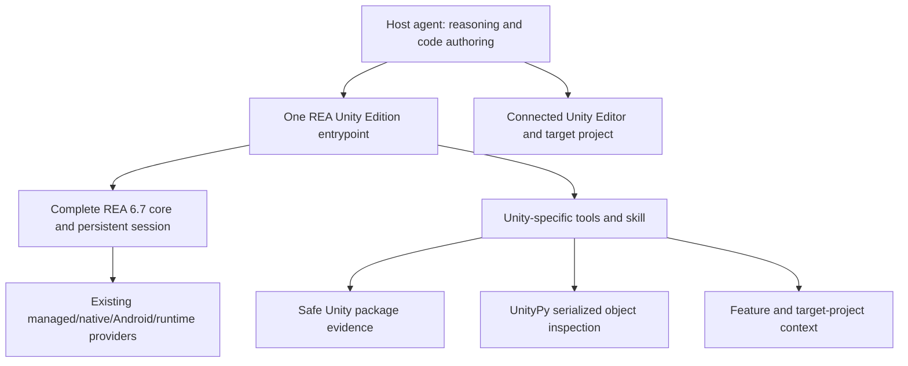
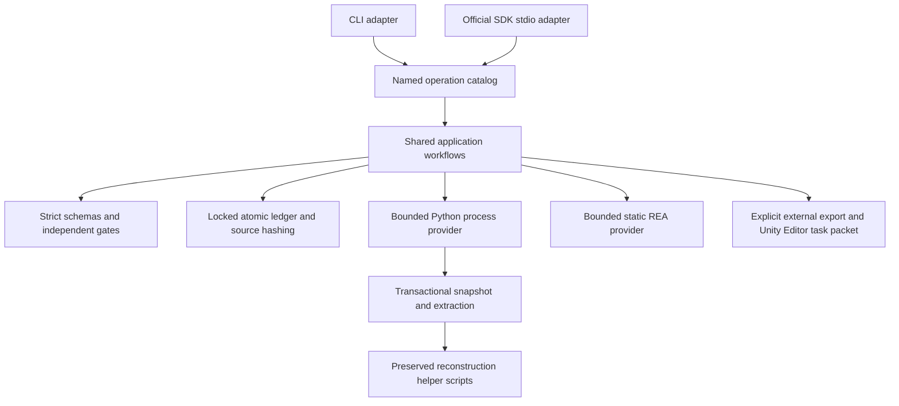

# REA-based Unity edition architecture (0.2)

The required `rea-agents@6.7.0` runtime provides the complete original REA CLI, MCP tools, binary sessions, providers and Evidence. The local sibling checkout is the architectural reference and remains unchanged. Using a pinned complete runtime keeps its engine implementations together; the Unity edition does not reimplement them.

Original CLI commands forward to the packaged core with inherited I/O and exit status. Domain commands are explicitly namespaced under `unity` so `analyze`, `inspect`, `doctor` and setup retain their original meaning.

The stdio broker runs one persistent core backend and one domain backend. It merges first-page discovery, forwards later core cursors (the current small Unity catalog is unpaged; paginated domain discovery is not implemented), preserves original JSON Schemas/result envelopes/structuredContent/Evidence metadata, and qualifies backend callback IDs. Core calls retain the same upstream session. Progress and cancellation go to the owning backend. Unsupported discovery families are omitted for that backend rather than converted into false empty core capability claims. The complete core skill is exposed as a domain resource.

Core process shutdown delegates engine cleanup to REA. The domain backend runs in its own POSIX process group so its direct helper group can receive shutdown signals. The broker applies stream backpressure; forced termination is a fallback, not evidence that arbitrary external provider descendants completed cleanup. Windows process-group behavior remains platform-dependent and is not covered by the current local tests.

The domain half retains the original evidence/ledger boundaries below. Optional UnityPy uses one admitted serialized file per invocation and returns source/raw hashes, qualified 64-bit PathIDs and typed decode limitations. Its present scope is SerializedFile formats 9–22, not arbitrary media export. UnityFS is handled separately by preflight-bounded exact-member extraction. IL2CPP adapters preserve provider provenance and ELF address domains. Target profiles feed hashed transfer plans and exclusively new feature folders; the host agent owns semantic adaptation and actual Editor checks. See [domain contracts](unity-domain-tools.md).

---

# Domain application architecture

REA's reference project separates domain contracts, providers, shared application workflows and CLI/MCP adapters. This project applies that direction without copying its large provider graph or unrelated binary engines.

- `src/domain/`: strict evidence, coverage, marker, roadmap and acceptance schemas; structured failures.
- `src/application/`: workspace intake, evidence retrieval, persisted state and delivery gates.
- `src/providers/`: supervised helper processes, provider discovery and optional REA integration.
- `src/operations.ts`: one named schema/handler owner consumed by both transports.
- `python/intake.py`: source snapshots and complete bounded raw extraction. Each supplied archive/split gets an independent root. Nested APKs are expanded one container layer.
- `skills/unity-game-reconstruction/scripts/`: original practice helpers, preserved with recorded hashes.

## Integrity and concurrency

Inputs are regular files; evidence symlinks and special files fail. Caller-selected parent aliases are canonicalized once, allowing macOS `/var` aliases. Inside the selected evidence/workspace boundary, symlink paths are rejected. A source handle is hashed and checked for changes while copying. CRC and declared lengths are verified during extraction.

Each ledger mutation owns an exclusive `.ledger-lock` directory and publishes a validated temporary JSON file using atomic rename. Source hashes are checked before records are accepted; `ready` rechecks relevant artifacts. A failed or interrupted writer may leave its lock. Do not remove one while a writer could still be active. Ledger mutation does not automatically repair or discard evidence.

`.incomplete` stays present until source intake, manifests and the initial ledger are published. A failed intake retains its private output for diagnosis; it is not a usable ready workspace. Reports use fresh UUID filenames.

These checks defend against untrusted package content and accidental edits. The process does not claim a secure multi-user boundary against another process actively replacing files owned by the same OS account. Recorded manifests/claims are local integrity records, not cryptographic attestations from a trusted third party.

## Budgets

Intake: 100,000 files/entries, 8 GiB per file/member, 32 GiB total directory or extracted members, 16 GiB archive, 128 MiB central directory, 200× per-member expansion, 64 extracted nested APKs. Original inspector limits also apply (including nested byte budgets and leaf limits). Stop reasons remain explicit. AAB is inventory/raw extraction only; installable APK production requires bundletool outside this process.

Queries: fixed strings, 5,000 files, 256 MiB total scan bytes, 8 MiB per file, 30 seconds, 24,000 output characters and 1–100 matches. The original scanner returns skipped/unscanned scope and clipping. Whole-corpus recovery obligations are independent of query budgets.

Helper output: 32 MiB and 300 seconds by default. REA: 8 MiB and 120 seconds. Timeout/overflow kills the directly owned child and waits for close. The bundled Python helpers do not start persistent services. External tool process-family cleanup is not guaranteed; select providers that do not daemonize. No ambient environment snapshot is stored.

## Extending

Add an explicit provider boundary with evidence/compatibility contracts. Reuse an existing schema owner. Add a named operation once, then test its real CLI and SDK MCP boundaries. External adapters must retain the source/tool identity, exact arguments, warnings and proof limits. Editor mutations require a configured provider and one owner; their lifecycle is delegated, never faked as successful by a handoff packet.
